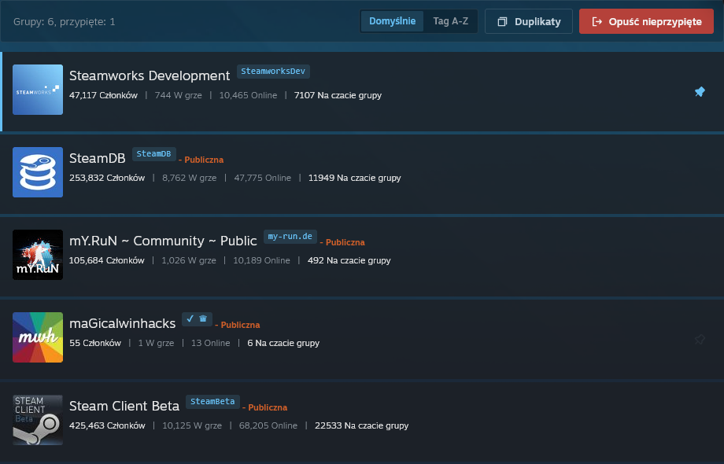
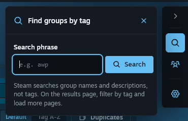
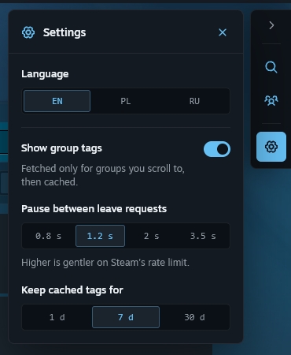
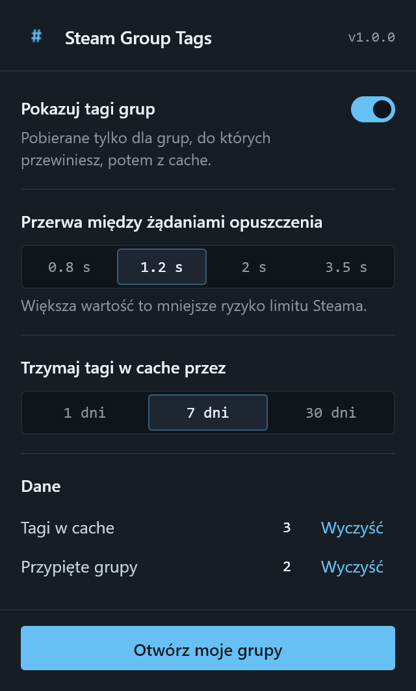

# Steam Group Tags

A lightweight browser extension for Steam Community that shows every group's **tag** (the clan tag you pick in CS2) right next to its name. You can also join groups in one click, find duplicate tags, hunt for tags in group search and leave groups in bulk.

It is built for people who collect Steam groups for their clan tags. It has no background process and no framework, and it asks for only one permission.



## Features

### On any group list (`/id/<name>/groups`, `/profiles/<id>/groups`)
- **Tags next to group names.** Click a tag to copy it.
- **Steam's own "Search groups" box finds tags too.**
- **Sort by tag (A-Z).** Groups without a tag go last.
- **Duplicates filter.** Shows only groups that share a tag. Matching ignores case and accents.

### On someone else's list
- **One-click Join** beside each group, so you don't have to open the group page.
  - **Request** for private groups.
  - **Invite only** (locked) for groups that need an invitation.
  - **Member** for groups you are already in.

### On your own list
- **Pin** the groups you want to keep. Pinned groups move to the top and get an accent edge.
- **Leave unpinned** leaves everything else in one go. You get a confirmation step, a progress bar and a Stop button.

### In group search (`/search/groups`)
- Tags and one-click Join on every result.
- **Filter loaded results by tag**, and **load more** results in place.
  Steam's search matches group names and descriptions, not tags, so this is how you hunt for a specific tag.

### Side dock
A slim icon rail on the right edge of the page:

| Find by tag | Settings |
|---|---|
|  |  |

- **Find by tag:** jump straight to group search.
- **My groups:** shows how many groups you are in, pinned groups and cached tags.
- **Settings:** language, tags on/off, pause between leave requests and cache lifetime.
- **Collapse** the rail into a small tab. The extension remembers it.

### Languages
English by default. **Polish** and **Russian** can be picked in the dock or in the toolbar popup.



The toolbar popup has the same settings as the dock.

## Install

The extension is not in a web store yet. Load it unpacked:

**Chrome, Edge, Brave, Opera**
1. Download this repository (Code, then Download ZIP) and unzip it, or `git clone` it.
2. Open `chrome://extensions` and turn on **Developer mode**.
3. Click **Load unpacked** and select the folder that contains `manifest.json`.

**Firefox 128+**
1. Open `about:debugging#/runtime/this-firefox`.
2. Click **Load Temporary Add-on** and select `manifest.json`.

There is no build step. The code is plain JavaScript, so nothing needs to be installed.

To update, pull or download the new version, then click the reload icon on the extension card in `chrome://extensions`.

## Performance

The goal is to stay invisible in Chrome's Task Manager.

- **No service worker or background page.** The extension uses 0 MB of memory when you are not on these Steam pages.
- **It runs only** on Steam friends/groups pages and on group search.
- **Tags are fetched only for rows near the viewport** (`IntersectionObserver`), at most 3 at a time. Sorting, the duplicates filter and the search filter fetch the remaining tags only when you use them.
- **Streamed and cancelled requests.** The tag sits in the page header, so the extension reads each group page as a stream and stops right after the tag. That is about 48 KB of an ~80 KB page.
- **Cache.** Tags are cached in `chrome.storage.local` for 7 days by default, so a second visit makes no requests.
- **Rate limits.** HTTP 429 triggers exponential backoff. Joins are sent in sequence and leaves in small batches with a pause between them.
- **Minimal DOM work.** There is one mutation observer, one delegated click listener and one stylesheet, and row reordering happens in a single pass. Everything is torn down when you navigate away.

## Privacy and permissions

| Permission | Why |
|---|---|
| `storage` | Tag cache, pinned groups and settings, stored locally in your browser. |

- The extension makes no requests outside `steamcommunity.com`, collects no analytics and sends nothing anywhere.
- It acts as your logged-in Steam session, the same way Steam's own buttons do.

## How it works

| What | Source |
|---|---|
| Group tag | Group page header (`.grouppage_header_abbrev`) |
| Invite-only | Join area icon `icon_inviteonly.png` (does not depend on language) |
| Join | Same form as the group page's **Join Group** button (`action=join`) |
| Leave | Same endpoint as Steam's own **Leave selected** (`friends/action`, `action=leave_group`) |
| Groups you are in | Your profile XML (gid list). Steam regenerates it at most hourly, so recent joins and leaves are tracked locally on top of it. |

All Steam selectors and endpoints live in `src/content/steam.js`. If Steam changes its markup, that is the file to update.

## Project structure

```text
manifest.json
_locales/{en,pl,ru}/      store name and description
icons/
docs/                     README screenshots
src/shared/i18n.js        UI strings (en, pl, ru), shared by content scripts and popup
src/content/
  steam.js                Steam selectors, endpoints, page context
  icons.js                icon paths (generated by tools/gen-icons.mjs)
  store.js                tag cache, pins, membership, settings
  tags.js                 streaming group-page parser and fetch queue
  join.js                 membership and joining
  leave.js                bulk leave
  ui.js                   tag badge, pin, join button, toolbars, dialog, toast
  dock.js                 right-edge dock (shadow DOM)
  main.js                 lifecycle, observers, sorting, duplicates, search filter
  content.css
src/popup/                toolbar popup
tools/gen-icons.mjs       regenerates icons.js from @phosphor-icons/core
```

## Contributing

Issues and pull requests are welcome. Please keep the extension light:
- No frameworks.
- No background process.
- No new permissions without a strong reason.

To add a language, add a block to `src/shared/i18n.js` and an entry to `SGT_LANGS`.

## Credits

- Icons: [Phosphor Icons](https://phosphoricons.com) (MIT).
- Not affiliated with or endorsed by Valve. Steam is a trademark of Valve Corporation.

## License

[MIT](LICENSE)
